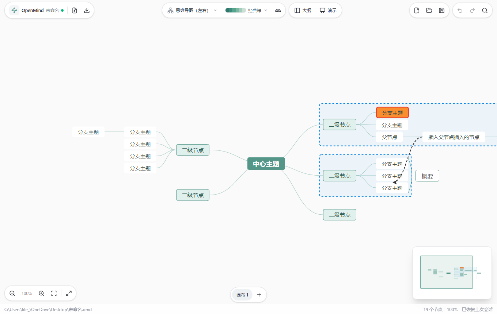
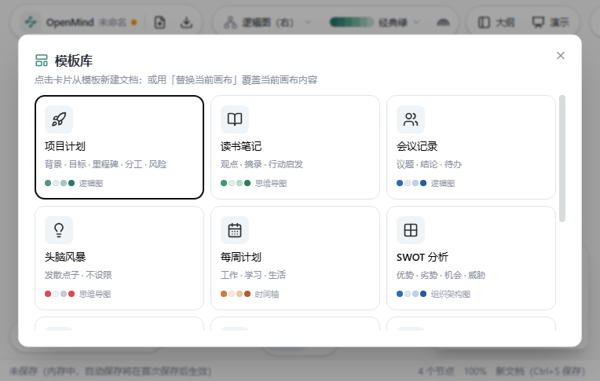
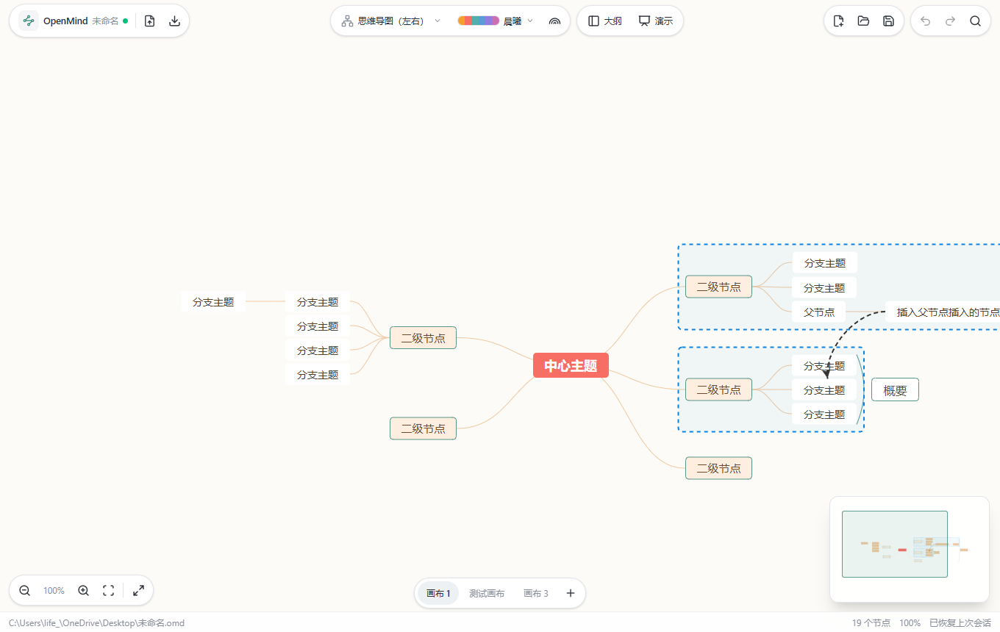

# OpenMind — 本地优先的开源思维导图（Windows 版 v0.5.2）

> 完全免费开源（GPL-3.0）· 无账号 · 无遥测 · 文件在你手里



| 模板库 | 主题切换 |
|---|---|
|  |  |

## 明天怎么用（快速上手）

### 安装

两种方式任选：

1. **安装包**（推荐）：从 [Releases](https://github.com/mox-hub/open-mind/releases) 下载 `OpenMind_0.5.2_x64-setup.exe`，
   双击安装后从开始菜单启动「OpenMind」。
2. **免安装绿色版**：下载 Release 附件中的 `open-mind.exe`，双击即可运行，可右键「发送到 → 桌面快捷方式」。

> 从源码自行构建：`npm run tauri build` 会产出 `src-tauri\target\release\bundle\nsis\OpenMind_0.5.2_x64-setup.exe` 与 `src-tauri\target\release\open-mind.exe`。

> 未购买代码签名证书，首次运行 Windows SmartScreen 可能提示「Windows 已保护你的电脑」：
> 点击「更多信息」→「仍要运行」即可。开源项目常见现象，无安全问题。

### 常用操作（前 5 分钟就会）

| 操作 | 方式 |
|---|---|
| 新建子节点 | 选中节点按 `Tab` |
| 新建同级节点 | 选中节点按 `Enter` |
| 编辑节点文字 | 双击节点，或选中后按 `F2` |
| 删除节点 | 选中后按 `Delete` |
| 移动节点 | 直接拖拽节点到目标位置 |
| 折叠/展开 | 节点左侧的 `-` / `+` 按钮 |
| 撤销 / 重做 | `Ctrl+Z` / `Ctrl+Y` |
| 缩放画布 | `Ctrl + 鼠标滚轮` |
| 平移画布 | 按住空白处拖动 / 触控板双指 |
| 保存 | `Ctrl+S`（首次会弹出另存为） |
| 打开 | `Ctrl+O` |
| 新建文档 | `Ctrl+N` |

### 文件与自动保存

- 文档保存为单个 `.omd` 文件（JSON 格式，开放可解析，可放进网盘/同步盘/Git）；
- **首次 `Ctrl+S` 选择位置后，之后每次修改会在 600ms 内自动保存**（原子写入，断电也不会产生半截文件）；
- 下次启动自动恢复上次打开的文档和视图位置（缩放、滚动）；
- 关闭窗口时如有未保存修改会自动保存/提示，不会丢数据。

### 导出

工具栏「导出」下拉：PNG / SVG / PDF / Markdown / OPML / TXT / XMind / FreeMind (.mm)。

### 主题与结构

- 7 个内置主题（含 2 个暗色主题）：工具栏下拉切换，主题随文档一起保存；
- **8 种结构**：逻辑图（右/左）、思维导图（左右）、组织架构图、目录组织图、时间轴（横向/竖向）、鱼骨图，随时切换。

---

## 当前版本范围（v0.5.2）

**已实现**：
- 核心编辑：增删改/拖拽/折叠/撤销重做/方向键导航/多选/节点上移下移/复制剪切粘贴
- **右键菜单**：插入各级节点、复制/剪切/粘贴、图标、标签、备注、链接、**图片**、概要、关联线、外框、展开控制、清除样式 + 画布菜单（展开/收起全部、重置布局、适应画布、全屏、删除关联线、查找、全选）
- **图标**：优先级 1-8 / 进度 / 表情 / 标记 四组（优先级与进度为单选语义，与 XMind 一致）
- **标签 / 备注 / 超链接 / 节点图片**（图片插入后可拖拽角点调整大小）
- **节点样式面板**：文字色/背景色/边框色与粗细/字号/加粗斜体/9 种形状
- **8 种结构**：逻辑图（右/左）、思维导图（左右）、组织架构图、目录组织图、时间轴（横向/竖向）、鱼骨图
- 7 个主题（含 2 个暗色，切换时 UI 壳同步变暗）、彩虹分支配色
- **多画布**：一个 `.omd` 文件可容纳多张画布（底部标签页切换、新建、删除）
- **模板库**：10 个内置模板（项目计划、读书笔记、会议记录、头脑风暴、每周计划、SWOT 分析、产品需求、学习笔记、项目复盘、旅行计划）
- **小地图**：随窗口等比缩放、视口框实时同步缩放平移、拖动小地图平移画布
- **大纲视图**：双视图同源编辑
- **查找替换**（`Ctrl+F`：查找 / 下一个 / 替换 / 全部替换，回车跳下一个）
- **演示模式**：画布全屏 + 逐级聚焦展开，`←` `→` 翻页、`Enter` 展示下划线文本、`Esc` 退出，底部悬浮控制条
- **导入**：Markdown / OPML / FreeMind (.mm) / XMind / TXT
- **导出**：PNG / SVG / **PDF** / Markdown / OPML / TXT / XMind / **FreeMind (.mm)**
- `.omd` 文件体系：自动保存（原子写）+ 会话恢复 + 未保存关闭时自动备份到「文档\OpenMind\未保存」
- 全屏（`F11`）、状态栏节点数/缩放比、按住 Ctrl 的快捷键速查浮层、中文界面

**窗口关闭策略**：有未保存修改时——已保存过的文档直接自动保存；新文档静默备份后关闭，绝不弹卡死对话框、绝不丢数据。

**快捷键速查**：`Tab` 子节点 · `Enter` 同级 · `Shift+Tab` 父节点 · `F2`/双击 编辑 · `Del` 删除 · `/` 展开收起 · `Ctrl+G` 概要 · `Ctrl+F` 查找 · `Ctrl+Enter` 居中 · `Ctrl+C/X/V` 复制剪切粘贴 · `Ctrl+A` 全选 · `Ctrl+Z/Y` 撤销重做 · `Ctrl+滚轮` 缩放 · `F11` 全屏

**暂未实现（规划中）**：富文本节点、每分支独立结构、大纲拖拽排序、任务日期、Office 导出、macOS 版、快捷键自定义。

**已知限制**：仅测试了 Windows 11 + Edge WebView2 环境；节点文字为纯文本。

## 开发

```bash
npm install          # 安装依赖
npm run tauri dev    # 开发模式（热更新）
npm run tauri build  # 打出 Release 安装包与 exe
```

技术栈：Tauri 2 + Vue 3 + TypeScript + Tailwind CSS v4 + shadcn-vue 风格组件（基于 Reka UI 无头组件）+ lucide 图标 + [simple-mind-map](https://github.com/wanglin2/mind-map)（MIT）。
设计文档：[docs/调研与设计方案.md](docs/调研与设计方案.md)

## 许可证

本项目以 [GPL-3.0](LICENSE) 许可发布，许可证全文见 [`LICENSE`](LICENSE)。其中 `simple-mind-map` 以 MIT 许可并入，其版权信息保留于其源码与 `node_modules`。
